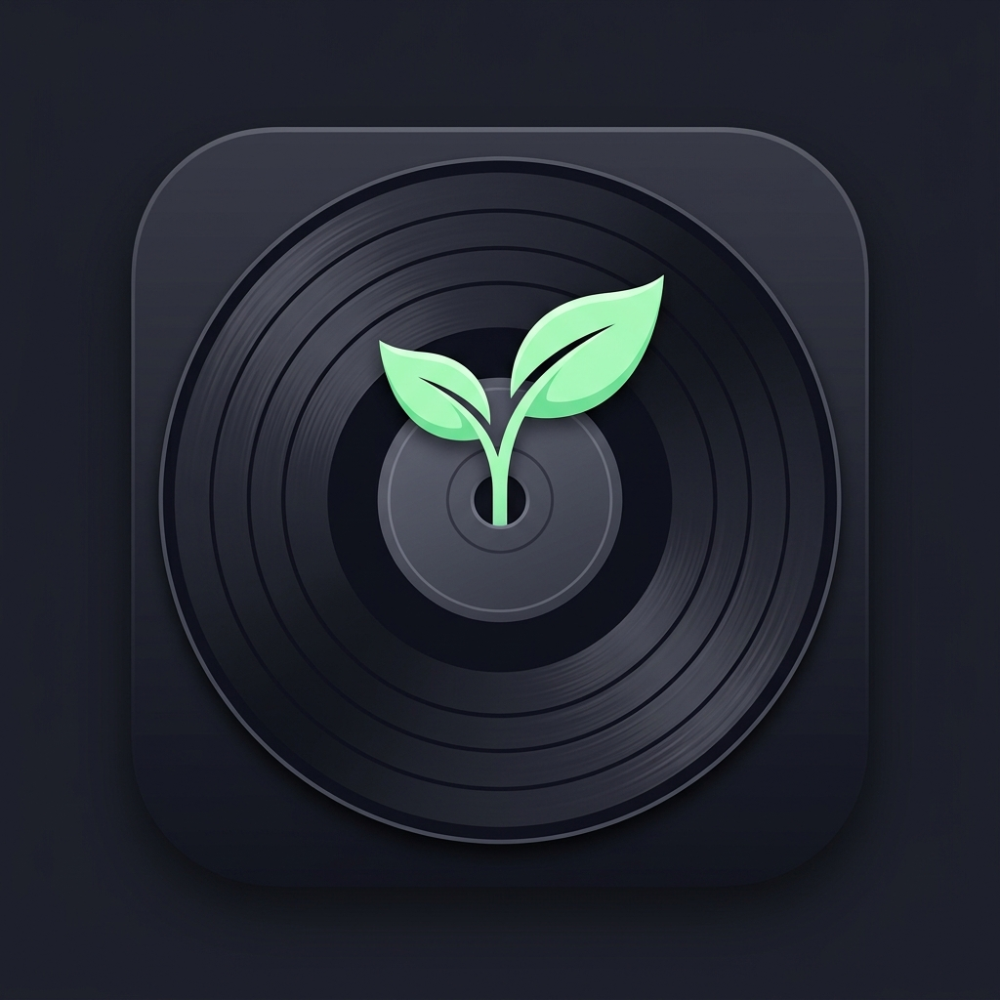
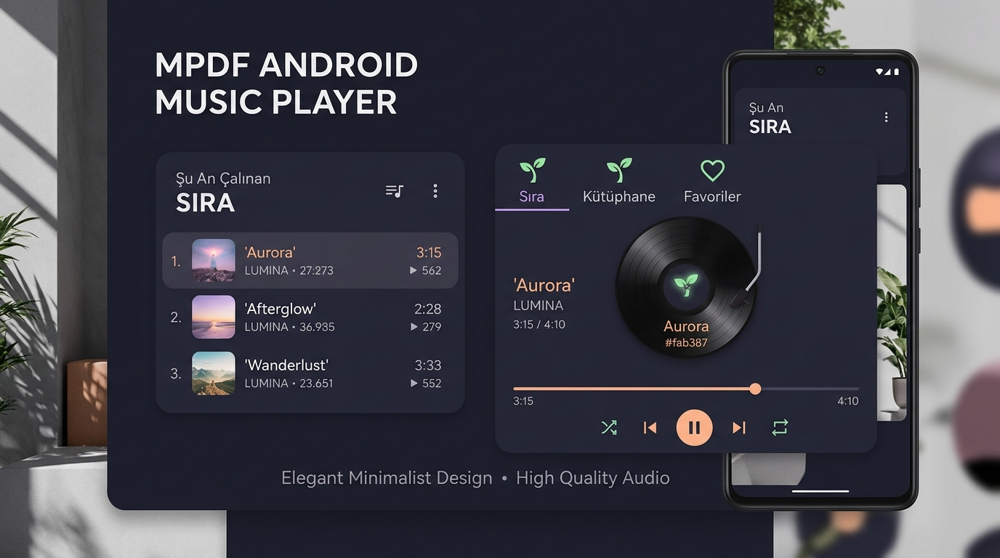

<div align="center">



# 🌱 MPDF
### Dedicated Music Player Daemon (MPD) Android Client & Hi-Fi Player
**Catppuccin Mocha Aesthetic • Warm Studio Ghibli Touch • AI Tag Editor & Curator**

[](https://developer.android.com)
[](https://kotlinlang.org)
[](https://developer.android.com/jetpack/compose)
[](#)
[](https://github.com/catppuccin/catppuccin)

<br/>



</div>

---

## 📖 Genel Bakış (Overview)

**MPDF**, modern Android ekosistemi için sıfırdan geliştirilmiş, yüksek çözünürlüklü ve üst seviye bir **Music Player Daemon (MPD)** uzaktan kumanda ve medya oynatıcı uygulamasıdır. 

Sıcak ve huzurlu **Studio Ghibli** detaylarıyla harmanlanmış **Catppuccin Mocha** renk paletine sahip olan MPDF; yerel ağdaki (Raspberry Pi, NAS veya PC) MPD sunucunuza doğrudan port 6600 üzerinden kesintisiz TCP soket bağlantısı kurar. Ayrıca MPD sunucusu olmayan ortamlarda tüm özellikleri deneyimleyebilmeniz için yerleşik bir **Studio Ghibli Demo Modu** ve doğrudan telefonunuzdan dinleyebilmeniz için **HTTP Ses Akışı (Stream Audio)** desteği sunar.

---

## 📸 Ekran Görüntüsü & Arayüz (Screenshots & UI)

<div align="center">
  
  <p><em>MPDF Arayüzü: Sıra (Queue), Kütüphane (Library), Favoriler (Favorites) ve Plak Animasyonlu Alt Oynatıcı</em></p>
</div>

---

## ✨ Temel Özellikler (Core Features)

### 1. 🎵 Gelişmiş Sıra Yönetimi (Queue / Sıra)
- **Akıllı Dokunma Hareketleri**:
  - **Tek Tıklama**: Parçayı seçer veya seçimini kaldırır (vurgulu Catppuccin Mauve rengiyle parlar).
  - **İki Kez Tıklama**: Şarkıyı anında oynatır.
- **Çalanın Arkasına Ekle (`queueNext`)**: Seçilen şarkıları anında çalan parçanın hemen peşine ekleme butonu.
- **Sade İşlem Çubuğu**: Sadece simgelerden oluşan modern araç çubuğu:
  - 🔘 **Tümünü Seç / Seçimi Kaldır** (`SelectAll`)
  - 💾 **Çalma Listesi Olarak Kaydet** (`BookmarkBorder`)
  - 🗑️ **Sırayı Temizle** (`Delete` çöp kutusu simgesi ve onay diyaloğu)
- **Gereksiz Etiketlerden Arındırılmış Temiz Liste**: Format bilgisi karmaşası olmadan odaklanmış müzik listesi.

### 2. 📂 Hiyerarşik Müzik Kütüphanesi (Library / Kütüphane)
- MPD'nin gerçek dizin yapısıyla senkronize klasör gezgini.
- Klasör içi parça sayıları ve alt klasör hiyerarşisi.
- Tek dokunuşla:
  - ⚡ **Hemen Çal (Play Now)**
  - ➕ **Sıraya Ekle (Enqueue)**
  - 📁 **Tüm Klasörü Sıraya Ekle (Enqueue Entire Folder)**

### 3. ❤️ Favoriler Sayfası (Favorites / Favoriler)
- **Hızlı Beğeni**: Now Playing dock'undaki kalp butonuna dokunarak çalan parçayı favorilere ekleme/çıkarma.
- **Kalıcı Saklama**: Beğenilen şarkılar cihaz hafızasında güvenle saklanır.
- **Toplu Sıraya Ekleme**: "Tümünü MPD Sırasına Ekle" butonu ile tek tıkla favori listesini sıraya doldurma.

### 4. 💽 Yapışkan Alt Oynatıcı (Sticky Now Playing Dock)
- **Dönen Plak (Vinyl Record)**: Şarkı çalarken dönen, duraklatıldığında duran dinamik vinil animasyonu ve ortasında filiz (🌱) amblemi.
- **Hassas Zaman Çubuğu (Scrubber Slider)**: Geçen ve toplam süre sayaçlarıyla akıcı şarkı arama.
- **Mini Ses Kaydırıcısı & Sessize Alma (Mute)**.
- **Tüm MPD Oynatma Modları**:
  - 🔀 **Karışık (Shuffle - z)**
  - 🔁 **Tekrar (Repeat - r)**
  - 🔂 **Tek Parça Tekrarı (Single - y)**
  - ⚡ **Tüketim Modu (Consume - x)**: Çalınan parçayı otomatik olarak sıradan siler.
  - ⏮️ ⏯️ ⏹️ ⏭️ **Tam Kontrol**: Önceki, Oynat/Duraklat, Durdur, Sonraki.

### 5. 🏷️ Akıllı Etiket Düzenleyici (Tag Editor & Sprout AI)
- **Tekil & Toplu Etiketleme**: Başlık, Sanatçı, Albüm, Tür, Yıl, Parça No ve Albüm Kapağı URL'si.
- **Kompakt Yapay Zeka Kartı**: Gemini destekli tek satırlık zarif Sprout AI butonu; dosya adından sanatçı ve albüm bilgilerini otomatik tahmin eder.
- **Albüm Kapağı Önizlemesi**: Canlı cover art önizleme ve hazır presetler.

### 6. 🌱 Sprout AI Müzik Küratörü
- Doğal dille ruh halinizi, ortamı veya dinleme zevkinizi anlatın; Sprout AI akustik gerekçelendirme ile size özel çalma listesi önersin ve tek tıkla MPD sırasına eklesin.

### 7. ⚙️ Ayarlar & Çoklu Dil Desteği
- 🇹🇷 **Türkçe** ve 🇬🇧 **English** tam yerelleştirme.
- TCP Host, Port (6600) ve Şifre yapılandırması.
- Canlı bağlantı testi ve milisaniye cinsinden **Ping gecikme ölçümü**.
- **HTTP Ses Akışı (Stream URL)** ile telefon hoparlöründen / kulaklığından doğrudan dinleme.
- **Studio Ghibli Demo Modu**: Canlı MPD sunucusu olmadan çevrimdışı tüm özellikleri deneme imkanı.

---

## 🎨 Tasarım Sistemi (Catppuccin Mocha Palette)

| Renk İsmi | Hex Kodu | Kullanım Alanı |
|---|---|---|
| **Base / Arka Plan** | `#1e1e2e` | Ana ekranlar ve derin arka plan |
| **Mantle / Yüzey** | `#181825` | Kartlar, üst ve alt çubuklar |
| **Surface0 / Kenarlıklar** | `#313244` | Giriş kutuları, ayırıcı çizgiler |
| **Peach Vurgusu** | `#fab387` | Çalan parça, zaman çizgisi, birincil vurgular |
| **Mauve Vurgusu** | `#cba6f7` | Aktif sekmeler, seçili parçalar, butonlar |
| **Green Vurgusu** | `#a6e3a1` | Filiz amblemi, bağlantı rozeti, yapay zeka |
| **Text (Birincil)** | `#cdd6f4` | Şarkı isimleri, ana başlıklar |
| **Subtext0 (İkincil)** | `#a6adc8` | Sanatçı/albüm alt yazıları, süreler |

---

## 🛠️ Mimari & Teknolojiler

- **Mimari**: Model-View-ViewModel (MVVM) & Clean Architecture
- **Arayüz**: Jetpack Compose, Material 3 (M3)
- **Asenkronluk**: Kotlin Coroutines & StateFlow / SharedFlow
- **Ağ İletişimi**: Asenkron TCP Socket Client (Port 6600, MPD Protocol v0.23+)
- **Yerel Ses Çalma**: Android MediaPlayer HTTP Stream Audio Player
- **Yapay Zeka**: Firebase AI Logic & Gemini API Entegrasyonu (App Check korumalı)
- **Görsel Yükleme**: Coil 2.7 (Asenkron Albüm Kapağı)
- **Test**: Robolectric JVM Testleri

---

## 🚀 Projeyi Derleme & Çalıştırma (Build & Run)

### Gereksinimler
- Android SDK 36 (Minimum SDK 24)
- Java 11 veya 17
- Gradle 8+

### Derleme Komutları
```bash
# Projeyi derleyin
gradle assembleDebug

# Birim ve Robolectric testlerini çalıştırın
gradle :app:testDebugUnitTest
```

---

<div align="center">
  <p>🌱 <em>Müziğin ve huzurun filizlendiği yer: MPDF</em></p>
</div>
